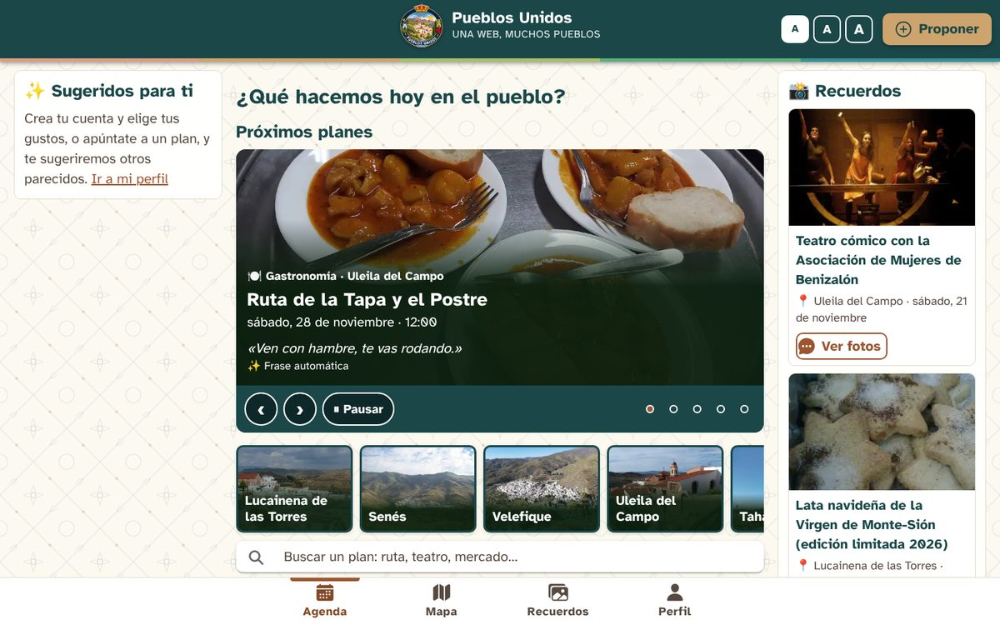
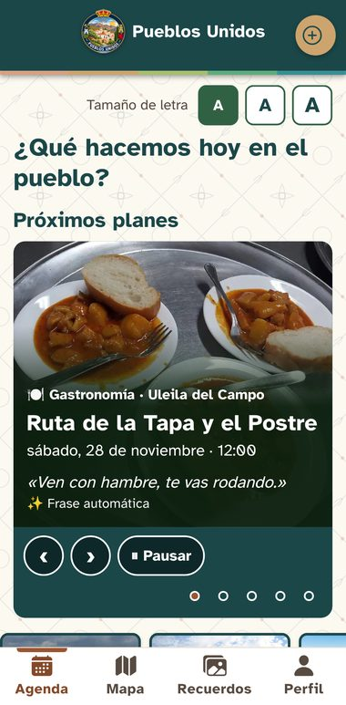
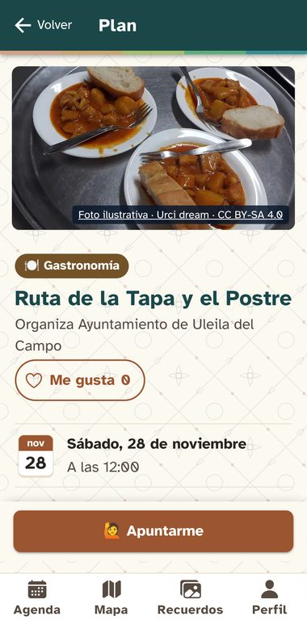
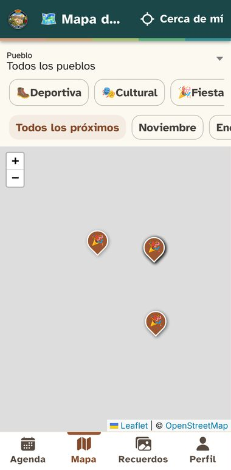

<div align="center">


# Pueblos Unidos

**Una web, muchos pueblos**

*Hackathon UAL para el Desarrollo del Interior · Reto 1 «Reactiva tu pueblo»*


**[🌐 Abrir la web](https://hackemate.rompelab.com)** · **[💬 Hablar con el bot](https://t.me/HackeMate_bot)** · **[📲 Descargar la app Android](https://hackemate.rompelab.com/descargas/pueblos-unidos.apk)**

</div>

---

## 🏡 El problema

En los pueblos del interior hay planes, pero nadie se entera. Están en un cartel pegado en el bar, en un post de Facebook del ayuntamiento o en un grupo de mensajes. Quien vive en el pueblo de al lado no lo sabe, y la gente mayor, menos.

## 💡 Nuestra solución

**Pueblos Unidos** junta en un solo sitio los planes de cinco pueblos de Almería: **Lucainena de las Torres, Senés, Velefique, Uleila del Campo y Tahal**. Nadie tiene que aprender una app nueva: el ayuntamiento manda un mensaje, una foto del cartel o un audio, y la vecina recibe el plan que le gusta y se apunta con un botón.

Tiene tres puertas que siempre están sincronizadas. Lo que pasa en una se ve al momento en las otras:

| | |
|:-:|:--|
| 💬 **Bot de Telegram con IA** | Publicar un plan con un texto, una foto o una nota de voz. Buscar planes hablando normal, apuntarse, preguntar y recibir avisos. Una persona mayor puede usarlo **solo con audios**, y el bot le contesta también con voz. |
| 📱 **Web y app Android** | Agenda, mapa, ficha de cada plan con inscripción, chat del plan, «me gusta», recuerdos con fotos y suscripción a Google Calendar. |
| 🏛️ **Panel del ayuntamiento** | Bandeja de moderación con antispam y antifraude, estadísticas de ocupación y asistencia, choques de fechas entre pueblos e ideas de planes nuevos. |

<div align="center">



<br><br>


&nbsp;

&nbsp;


</div>

## 👣 Tres personas, tres recorridos

| 👵 **Carmen, vecina de Senés** | 🏛️ **Ayuntamiento de Velefique** | 🎉 **Una asociación del pueblo** |
|:--|:--|:--|
| 1. Le llega por Telegram un plan según sus gustos. | 1. Reenvía al bot el post de Facebook o un audio. | 1. Se da de alta con el DNI de su responsable. |
| 2. Se apunta con un botón, desde el bot, la web o la app. | 2. La IA hace la ficha y avisa si la fecha choca con otro pueblo. | 2. El ayuntamiento la revisa y la aprueba. |
| 3. Pregunta en el chat del plan y la IA le contesta. | 3. Confirma con un botón y el plan se publica. | 3. Manda sus planes por el bot o por la web. |
| 4. Si cambia la hora, le llega un aviso, y además le ofrecen compartir coche. | 4. En el panel ve la bandeja, el fraude, las cifras y las ideas de la IA. | 4. Sus planes pasan por la bandeja hasta que se gana la confianza. |

## ✨ Lo que nos diferencia

1. **Nadie cambia sus costumbres.** El ayuntamiento sigue publicando como siempre y la vecina se apunta desde Telegram.
2. **Pensado para personas mayores.** Notas de voz que se contestan con voz, letra grande y una «radio del pueblo» cada lunes.
3. **La IA propone y una persona decide.** Cada aviso de la bandeja viene con su motivo, y un plan editado vuelve a revisión.
4. **El pueblo como comunidad.** Compartir coche con el sí de los dos, recuerdos con fotos y avisos de choque de fechas.
5. **Funciona aunque algo falle.** Si una IA no responde, se pasa a la siguiente, y si fallan todas, quedan las reglas. Los avisos esperan en cola si el bot se cae.
6. **Coste cero, y medido.** Solo usamos proveedores gratuitos, y el panel enseña las llamadas, los tokens y los euros de cada uno.
7. **Datos reales y seguros.** Planes reales de los cinco pueblos, DNI que solo ve la moderación y auditoría de seguridad OWASP.

## 🚀 Cómo probarlo

- **Web:** abre **https://hackemate.rompelab.com**. Para mirar la agenda y el mapa no hace falta cuenta.
- **Bot:** escribe a **[@HackeMate_bot](https://t.me/HackeMate_bot)** en Telegram, por ejemplo «¿qué hay este finde en Senés?», o mándale un audio.
- **App Android:** en la web, entra en *Perfil* y escanea el QR, o [descarga el APK](https://hackemate.rompelab.com/descargas/pueblos-unidos.apk).
- **Panel del ayuntamiento:** entra en *Perfil → Entrar en la zona del ayuntamiento*.

¿Quieres levantarlo en tu ordenador? Con Docker son tres comandos:

```bash
cp .env.example .env
docker compose --env-file .env -f infra/docker-compose.yml up -d --build
# Web en http://localhost:8080
```

## 🛠️ Con qué está hecho


```
         📱 Web / APK            💬 Telegram            🏛️ Panel
              │                       │                     │
              └──────────┐   ┌────────┘                     │
                         ▼   ▼                              │
                    ┌──────────────┐   avisos / IA   ┌─────────────┐
                    │   API        │ ◀─────────────▶ │   Bot + IA   │
                    │  (FastAPI)   │                 │ Gemini → NIM │
                    └──────┬───────┘                 │ → FreeLLM →  │
                           │                         │   reglas     │
                     ┌─────▼─────┐                   └─────────────┘
                     │ PostgreSQL│
                     └───────────┘
```

Una sola API es la que guarda los datos y decide. El bot es el único que habla con Telegram y con la IA, y la web, el APK y el panel son la misma app. Tests automáticos en verde: **716 de la API, 239 del bot y 69 de la web**.

📖 **Toda la parte técnica** (arquitectura, variables, rutas, cómo se arranca cada servicio, decisiones y la lista de cambios) está en **[`docs/TECNICO.md`](docs/TECNICO.md)**.

## 👥 Equipo

<div align="center">

| 🧑‍💻 **Adán Álvarez Amat** | 🧑‍💻 **Francisco Sánchez López** | 🧑‍💻 **Benas Sapogas** | 🧑‍💻 **Juan Carlos Pascual Escañuela** |
|:-:|:-:|:-:|:-:|
| Web, app Android y panel | Bot, IA y API | API y datos | Equipo |

<br>

*Hecho en 48 horas en la Universidad de Almería, para los pueblos del interior.*

</div>
